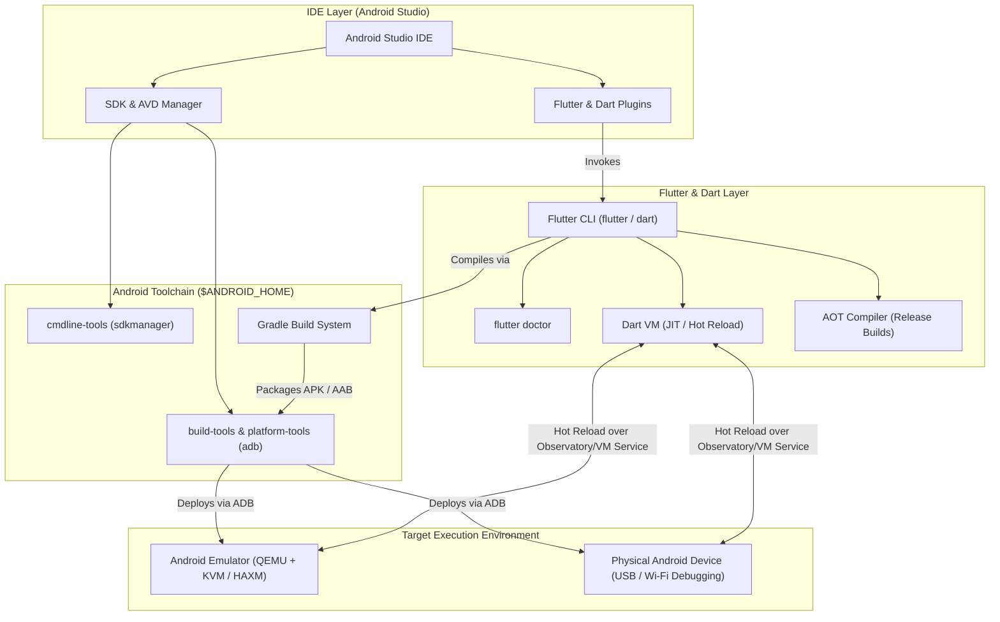

## Overview

Setting up a mobile app development environment with **[[Flutter]]** and **Android Studio** requires configuring two primary ecosystems: the **Flutter SDK** (which includes the **Dart SDK**) and the **Android Toolchain** (Android SDK, Command-line Tools, Platform-Tools, and the Android Emulator).

Android Studio acts as both the primary Integrated Development Environment (IDE)—providing code completion, widget inspection, performance profiling, and debugging—and the manager for Android SDK components and Virtual Devices (AVDs).

---

## Architecture / Visual Diagram

The following diagram illustrates how your IDE, the [[Flutter]] SDK, the Android Toolchain, and the target execution environment interact during development:



---

## Step-by-Step Environment Setup

### 1. Install Prerequisites & Android Studio

#### On [[Linux]] ([[CachyOS]] / Arch Linux)

Install required system dependencies, Java JDK, and Android Studio (either directly from AUR or via **JetBrains Toolbox**):

```bash
# 1. Install required host packages and Java OpenJDK
sudo pacman -S --needed curl git unzip xz zip glu jdk17-openjdk

# 2. Install Android Studio via AUR (or use jetbrains-toolbox)
paru -S android-studio
```

> [!TIP]
> If you already installed `jetbrains-toolbox` (see [[CachyOS]]), you can install and auto-update **Android Studio** directly from the Toolbox GUI.

#### On [[Windows]]

Using `winget` in [[PowerShell]]:

```powershell
winget install -e --id Google.AndroidStudio
winget install -e --id Git.Git
```

---

### 2. Install the Flutter SDK

While package managers exist, installing the [[Flutter]] SDK by cloning the `stable` branch into a dedicated user directory (e.g., `~/development/flutter`) avoids root permission issues when running `flutter upgrade`.

```bash
# Create a development directory if it doesn't exist
mkdir -p ~/development
cd ~/development

# Clone the stable branch of Flutter SDK
git clone https://github.com/flutter/flutter.git -b stable
```

#### Configure Environment Variables (`PATH` and `ANDROID_HOME`)

Add the Flutter binary and Android SDK paths to your shell configuration:

**For `fish` (`~/.config/fish/config.fish`):**

```fish
# Flutter SDK
fish_add_path $HOME/development/flutter/bin

# Android SDK (default path created by Android Studio)
set -gx ANDROID_HOME $HOME/Android/Sdk
fish_add_path $ANDROID_HOME/cmdline-tools/latest/bin
fish_add_path $ANDROID_HOME/platform-tools
fish_add_path $ANDROID_HOME/emulator
```

**For `bash` / `zsh` (`~/.bashrc` or `~/.zshrc`):**

```bash
export ANDROID_HOME="$HOME/Android/Sdk"
export PATH="$PATH:$HOME/development/flutter/bin"
export PATH="$PATH:$ANDROID_HOME/cmdline-tools/latest/bin:$ANDROID_HOME/platform-tools:$ANDROID_HOME/emulator"
```

Reload your shell and verify:

```bash
flutter --version
```

---

### 3. Configure Android Studio & SDK Command-Line Tools

1. Launch **Android Studio** and complete the **Setup Wizard** (choose *Standard* installation to download the latest Android SDK, Android SDK Platform-Tools, and Android Emulator).
2. **Install Command-Line Tools (Critical for `flutter doctor`)**:
   - From the Welcome screen, go to **More Actions** (or **Settings** `Ctrl+Alt+S`) $\rightarrow$ **Languages & Frameworks** $\rightarrow$ **Android SDK**.
   - Select the **SDK Tools** tab.
   - Check ✅ **Android SDK Command-line Tools (latest)**.
   - Check ✅ **Android SDK Platform-Tools** and **Android Emulator**.
   - Click **Apply** and **OK** to download and install.
3. **Install the Flutter & Dart Plugins**:
   - In Android Studio, open **Plugins** from the left sidebar (or **Settings** $\rightarrow$ **Plugins**).
   - Search the **Marketplace** for **Flutter** and click **Install**.
   - When prompted to also install the **Dart** plugin, click **Yes**.
   - Click **Restart IDE**.

---

### 4. Accept Android Licenses & Run `flutter doctor`

Once the SDK Command-line Tools are installed, accept all Android SDK licenses via the terminal:

```bash
flutter doctor --android-licenses
```

*(Type `y` at each prompt to accept the licenses.)*

Next, verify your entire setup using `flutter doctor`:

```bash
flutter doctor -v
```

You should see green checkmarks next to **Flutter**, **Android toolchain**, **Chrome**, and **Android Studio**:

```text
Doctor summary (to see all details, run flutter doctor -v):
[✓] Flutter (Channel stable, 3.x.x, on Linux, locale en_US.UTF-8)
[✓] Android toolchain - develop for Android devices (Android SDK version 35.0.0)
[✓] Chrome - develop for the web
[✓] Linux toolchain - develop for Linux desktop
[✓] Android Studio (version 2024.x)
[✓] Connected device (2 available)
[✓] Network resources
```

---

### 5. Set Up Hardware Acceleration & Android Emulator (AVD)

#### Enable KVM Hardware Acceleration on [[Linux]]

Android Emulator requires **KVM** (Kernel-based Virtual Machine) on Linux for smooth 60–120 FPS performance:

```bash
# 1. Verify CPU virtualization support (returns > 0 if supported)
grep -E -c '(vmx|svm)' /proc/cpuinfo

# 2. Install qemu and kvm utilities on Arch / CachyOS
sudo pacman -S --needed qemu-desktop libvirt

# 3. Add your user to the kvm group so Android Studio can access /dev/kvm
sudo usermod -aG kvm $USER
```

*(Log out and log back in, or run `newgrp kvm`, for group permissions to take effect.)*

#### Create an Android Virtual Device (AVD)

1. Open Android Studio $\rightarrow$ **More Actions** $\rightarrow$ **Virtual Device Manager**.
2. Click **Create Device** (`+`).
3. Select a device definition (e.g., **Pixel 8 Pro** with Play Store icon) and click **Next**.
4. Download the latest **System Image** (e.g., API 35 / Android 15 `x86_64`) and select it.
5. Under **Emulated Performance** $\rightarrow$ **Graphics**, select **Hardware - GLES 2.0** for GPU acceleration.
6. Click **Finish** and press the **Play** ($\triangleright$) button to boot the emulator.

---

## Code Example

Once your environment and emulator are ready, you can create a new [[Flutter]] project either from the Android Studio welcome screen (**New Flutter Project**) or via the CLI:

```bash
flutter create my_mobile_app
cd my_mobile_app
flutter run
```

Below is a complete, runnable example (`lib/main.dart`) demonstrating **Material 3** theming, responsive state management with `StatefulWidget`, and a clean mobile layout:

```dart
import 'package:flutter/material.dart';

void main() {
  runApp(const TaskTrackerApp());
}

class TaskTrackerApp extends StatelessWidget {
  const TaskTrackerApp({super.key});

  @override
  Widget build(BuildContext context) {
    return MaterialApp(
      title: 'Flutter Dev Setup Demo',
      debugShowCheckedModeBanner: false,
      theme: ThemeData(
        colorScheme: ColorScheme.fromSeed(
          seedColor: Colors.indigo,
          brightness: Brightness.light,
        ),
        useMaterial3: true,
      ),
      darkTheme: ThemeData(
        colorScheme: ColorScheme.fromSeed(
          seedColor: Colors.indigo,
          brightness: Brightness.dark,
        ),
        useMaterial3: true,
      ),
      themeMode: ThemeMode.system,
      home: const HomeScreen(),
    );
  }
}

class HomeScreen extends StatefulWidget {
  const HomeScreen({super.key});

  @override
  State<HomeScreen> createState() => _HomeScreenState();
}

class _HomeScreenState extends State<HomeScreen> {
  final List<String> _tasks = [
    'Install Android Studio & SDK Command-line Tools',
    'Verify setup with flutter doctor -v',
    'Enable KVM hardware acceleration for Emulator',
  ];

  final TextEditingController _controller = TextEditingController();

  void _addTask() {
    final text = _controller.text.trim();
    if (text.isEmpty) return;

    setState(() {
      _tasks.add(text);
      _controller.clear();
    });
  }

  void _removeTask(int index) {
    setState(() {
      _tasks.removeAt(index);
    });
  }

  @override
  void dispose() {
    _controller.dispose();
    super.dispose();
  }

  @override
  Widget build(BuildContext context) {
    return Scaffold(
      appBar: AppBar(
        title: const Text('Mobile Dev Checklist'),
        centerTitle: true,
      ),
      body: Column(
        children: [
          Padding(
            padding: const EdgeInsets.all(16.0),
            child: Row(
              children: [
                Expanded(
                  child: TextField(
                    controller: _controller,
                    decoration: const InputDecoration(
                      labelText: 'Add a new development task',
                      border: OutlineInputBorder(),
                    ),
                    onSubmitted: (_) => _addTask(),
                  ),
                ),
                const SizedBox(width: 12),
                FilledButton.icon(
                  onPressed: _addTask,
                  icon: const Icon(Icons.add),
                  label: const Text('Add'),
                ),
              ],
            ),
          ),
          Expanded(
            child: ListView.builder(
              itemCount: _tasks.length,
              itemBuilder: (context, index) {
                return Dismissible(
                  key: ValueKey(_tasks[index] + index.toString()),
                  onDismissed: (_) => _removeTask(index),
                  background: Container(
                    color: Colors.redAccent,
                    alignment: Alignment.centerRight,
                    padding: const EdgeInsets.symmetric(horizontal: 20),
                    child: const Icon(Icons.delete, color: Colors.white),
                  ),
                  child: ListTile(
                    leading: CircleAvatar(child: Text('${index + 1}')),
                    title: Text(_tasks[index]),
                    trailing: IconButton(
                      icon: const Icon(Icons.check_circle_outline),
                      onPressed: () => _removeTask(index),
                    ),
                  ),
                );
              },
            ),
          ),
        ],
      ),
    );
  }
}
```

---

## Essential CLI & IDE Shortcuts

| Action | Android Studio Shortcut | CLI Equivalent (during `flutter run`) |
| :--- | :--- | :--- |
| **Hot Reload** (inject UI changes in `<1s`) | `Ctrl + \` (or Save `Ctrl + S`) | Press `r` |
| **Hot Restart** (reset app state) | `Ctrl + Shift + \` | Press `R` |
| **Open Flutter DevTools** (Inspector / Profiler) | Click **Flutter Inspector** tab | Press `v` |
| **Run App** | `Shift + F10` | `flutter run` |
| **Debug App** | `Shift + F9` | `flutter run --debug` |
| **List Connected Devices / Emulators** | Device Dropdown in Toolbar | `flutter devices` / `flutter emulators` |

---

## Key Considerations & Best Practices

- **`cmdline-tools component is missing` Error**: This is the most common issue reported by `flutter doctor`. Always ensure **Android SDK Command-line Tools (latest)** is checked inside Android Studio's **SDK Manager $\rightarrow$ SDK Tools** tab before running `flutter doctor --android-licenses`.
- **JDK Version Mismatch with Gradle**: Android Studio bundles its own JetBrains Runtime (JBR / JDK). If `flutter doctor` or Gradle complains about an incompatible Java version, point Flutter to Android Studio's bundled JDK:
  ```bash
  flutter config --jdk-dir="/opt/android-studio/jbr"
  ```
- **Wayland & Hyprland Window Tiling Fixes**: On tiling window managers like [[Configure Hyprland]], Android Studio popups or the Android Emulator toolbar can occasionally misbehave. Add window rules in `~/.config/hypr/hyprland.conf` to float the emulator and fix Java AWT focus issues:
  ```ini
  windowrulev2 = float, class:^(Emulator)$
  windowrulev2 = noinitialfocus, class:^(jetbrains-studio)$, title:^win(.*)$
  ```
- **Avoid Installing Flutter as `root`**: Never place the Flutter SDK in `/opt` or `/usr/local` with `sudo`, and avoid `snap` packages on Linux, as Flutter frequently writes to its own SDK directory during package resolution and upgrades.
- **Physical Device Wireless Debugging**: To save RAM instead of running an Android Emulator, go to your Android phone's **Developer Options $\rightarrow$ Wireless Debugging**, and pair it directly in Android Studio via **Pair Devices Using Wi-Fi** (QR code).

---

## Related Notes

- [[Flutter]]
- [[CachyOS]]
- [[Linux]]
- [[Configure Hyprland]]
- [[Visual Studio Code]]
- [[Clean Architecture]]
