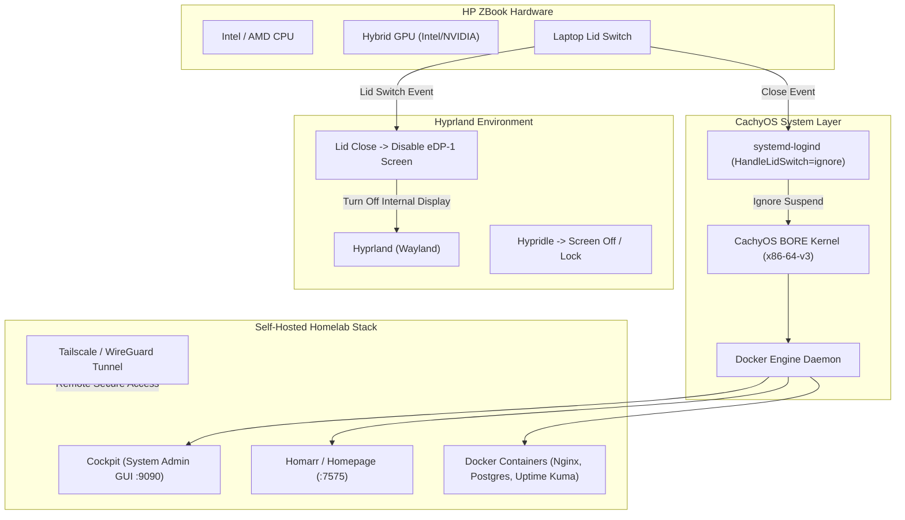

## Overview

Setting up an **HP ZBook** laptop as a **Homelab Server and Workstation** running **CachyOS** and **Hyprland** gives you a high-performance, power-efficient self-hosting server with a sleek tiling window manager GUI. 

This guide covers configuring system daemon behavior so the server stays active when the lid is closed, managing hybrid GPUs (Intel/AMD iGPU + NVIDIA dGPU), configuring Hyprland for dual-mode operation (desktop workstation & headless home server), and deploying a containerized homelab environment using Docker and remote management tools.

---

## Key Concepts & How It Works

- **Lid-Closed Server Operation**: Modern laptops suspend when the lid is closed by default. We configure `systemd-logind` to ignore lid switches while allowing Hyprland to turn off the physical screen to conserve power and reduce heat.
- **CachyOS Performance Kernel**: CachyOS utilizes the BORE scheduler and CPU microarchitecture optimizations (x86-64-v3/v4), providing ultra-low latency for container workloads and smooth Wayland rendering.
- **Hyprland Tiling & Control Station**: Serves as a lightweight dashboard interface when using the ZBook directly, using terminal multiplexers (`zellij`/`tmux`), system monitors (`btop`), and Wayland utilities (`waybar`).
- **Containerized Service Stack**: Runs services (Homarr, Cockpit, Uptime Kuma, PostgreSQL, Nginx) inside Docker containers with `restart: unless-stopped` to maintain high availability.
- **Secure Remote Access**: Uses WireGuard or Tailscale to securely access self-hosted services from anywhere without exposing ports directly to the open internet.

---

## Visual Diagram



---

## Step-by-Step Setup Guide

### 1. Configure Systemd to Keep Server Running on Lid Close

Edit `/etc/systemd/logind.conf` to prevent the laptop from entering suspend mode when the lid is closed:

```bash
sudo nvim /etc/systemd/logind.conf
```

Uncomment and update the following settings:

```ini
[Login]
HandleLidSwitch=ignore
HandleLidSwitchExternalPower=ignore
HandleLidSwitchDocked=ignore
```

Apply the changes:

```bash
sudo systemctl restart systemd-logind
```

---

### 2. Configure Hyprland Display Management for Lid Close

Add lid switch triggers to `~/.config/hypr/hyprland.conf` so closing the lid turns off the internal display (saving power and heat) without suspending system processes:

```ini
# ~/.config/hypr/hyprland.conf

# Detect internal display name using: hyprctl monitors
$mainMonitor = eDP-1

# Turn off laptop display on lid close, turn back on when opened
bindl = , switch:on:Lid Switch, exec, hyprctl keyword monitor "$mainMonitor, disable"
bindl = , switch:off:Lid Switch, exec, hyprctl keyword monitor "$mainMonitor, preferred, auto, 1"

# NVIDIA Hybrid Graphics Optimization (HP ZBook dGPU)
env = LIBVA_DRIVER_NAME,nvidia
env = XDG_SESSION_TYPE,wayland
env = GBM_BACKEND,nvidia-drm
env = __GLX_VENDOR_LIBRARY_NAME,nvidia
```

---

### 3. Configure Screen Idle and Power Management

Install and configure `hypridle` to manage screen timeout while keeping server daemons active:

```bash
sudo pacman -S hypridle hyprlock
```

Create `~/.config/hypr/hypridle.conf`:

```ini
general {
    lock_cmd = pidof hyprlock || hyprlock
    before_sleep_cmd = loginctl lock-session
    after_sleep_cmd = hyprctl dispatch dpms on
}

# Turn off display after 10 minutes of inactivity (do NOT sleep OS)
listener {
    timeout = 600
    on-timeout = hyprctl dispatch dpms off
    on-resume = hyprctl dispatch dpms on
}
```

---

### 4. Enable Docker & Container Services

Install Docker and set up user permissions for homelab deployments:

```bash
# Install Docker and Docker Compose
sudo pacman -S docker docker-compose lazydocker

# Start and enable Docker daemon on boot
sudo systemctl enable --now docker.service

# Add current user to docker group
sudo usermod -aG docker $USER
newgrp docker
```

---

### 5. Deploy Homelab Control Stack (`docker-compose.yml`)

Create a homelab deployment directory:

```bash
mkdir -p ~/homelab && cd ~/homelab
nvim docker-compose.yml
```

Add the following services:

```yaml
version: '3.8'

services:
  # Homelab Dashboard
  homarr:
    image: ghcr.io/ajnart/homarr:latest
    container_name: homarr
    restart: unless-stopped
    ports:
      - "7575:7575"
    volumes:
      - ./homarr/configs:/app/data/configs
      - ./homarr/icons:/app/public/icons
      - ./homarr/data:/data

  # Uptime Kuma Monitoring
  uptime-kuma:
    image: louislam/uptime-kuma:1
    container_name: uptime-kuma
    restart: unless-stopped
    ports:
      - "3001:3001"
    volumes:
      - ./uptime-kuma:/app/data

  # Nginx Proxy Manager
  nginx-proxy-manager:
    image: 'jc21/nginx-proxy-manager:latest'
    container_name: nginx-proxy-manager
    restart: unless-stopped
    ports:
      - '80:80'
      - '81:81'
      - '443:443'
    volumes:
      - ./npm/data:/data
      - ./npm/letsencrypt:/etc/letsencrypt
```

Start the homelab services:

```bash
docker compose up -d
```

---

### 6. Install Cockpit for Web-Based Linux Server Administration

Cockpit provides an intuitive browser interface to monitor CPU/RAM metrics, thermal sensors, storage, systemd services, and terminal access:

```bash
sudo pacman -S cockpit cockpit-storaged cockpit-machines
sudo systemctl enable --now cockpit.socket
```

Access Cockpit at: `https://localhost:9090` (or `https://<hp-zbook-ip>:9090`).

---

### 7. Setup Secure Remote Access with Tailscale

Install Tailscale to securely access your ZBook homelab from anywhere:

```bash
sudo pacman -S tailscale
sudo systemctl enable --now tailscaled
sudo tailscale up
```

---

## Latest Trends & Best Practices

- **Dynamic CPU Power Scaling**: Use `auto-cpufreq` alongside `power-profiles-daemon` to ensure the HP ZBook downclocks when idle, reducing heat output while the lid is closed.
- **Btrfs Snapshots**: Utilize CachyOS's native `btrfs` filesystem with `snapper` to take automatic system state snapshots before kernel or driver upgrades.
- **Container Health Monitoring**: Monitor container resource usage with `lazydocker` directly from the Hyprland terminal or via **Beszel** / **Uptime Kuma** on your web dashboard.
- **Battery Threshold Limit**: Set maximum battery charge thresholds (e.g., 80%) in HP ZBook BIOS or `/sys/class/power_supply/BAT0/charge_control_end_threshold` to prolong battery life during continuous AC power operation.

---

## Related Notes

- [[CachyOS]]
- [[Configure Hyprland]]
- [[Hyprland-NVIDIA-GPU-Acceleration]]
- [[Linux]]
- [[Docker]]
- [[Nginx]]
- [[PostgreSQL]]
- [[Pacman Basic Usage]]
