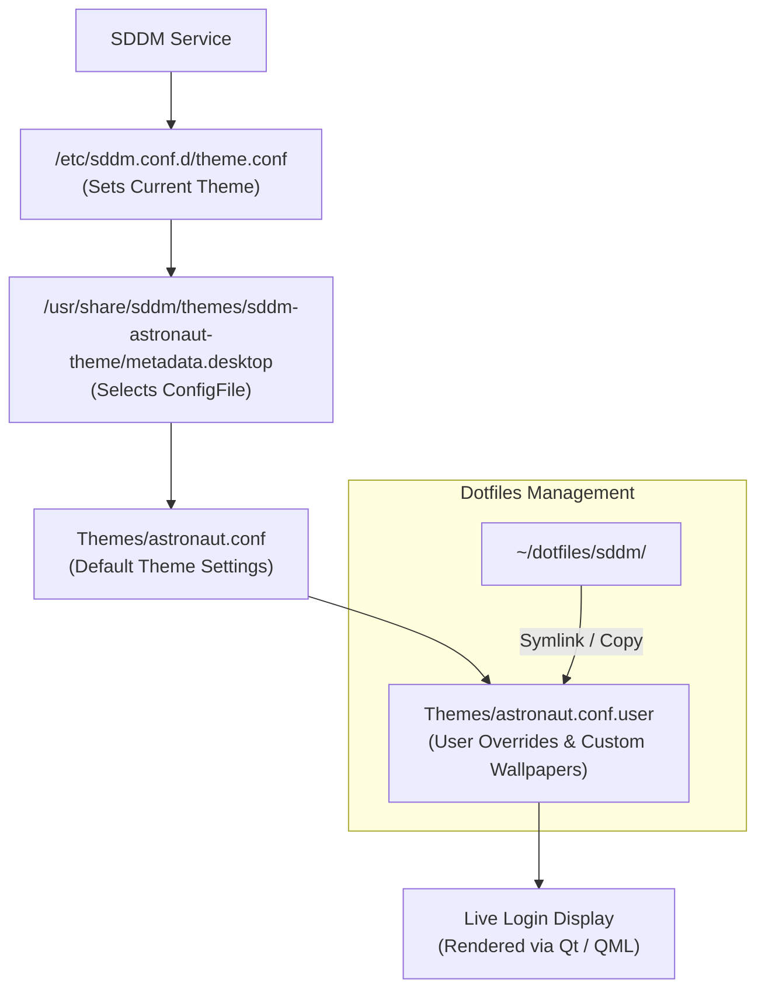

## Overview

SDDM (Simple Desktop Display Manager) is a modern, lightweight display manager for Linux that handles user authentication and session launching. Customizing SDDM—especially when using feature-rich themes like `sddm-astronaut-theme`—allows you to personalize your login screen with custom wallpapers (including animated GIFs and MP4 videos), custom fonts, custom layouts, and clock formats.

## Key Concepts & How It Works

- **Global Config (`/etc/sddm.conf` or `/etc/sddm.conf.d/`)**: Defines system-wide SDDM behavior and specifies the active theme engine via `[Theme] Current=sddm-astronaut-theme`.
- **Theme Metadata (`metadata.desktop`)**: Located inside the theme directory (`/usr/share/sddm/themes/sddm-astronaut-theme/metadata.desktop`). It points SDDM to the active layout configuration using `ConfigFile=Themes/<preset>.conf`.
- **Preset Configurations (`Themes/*.conf`)**: `sddm-astronaut-theme` ships with pre-configured styles (such as `astronaut.conf`, `cyberpunk.conf`, `black_hole.conf`, `hyprland_kath.conf`, etc.).
- **User Override File (`*.conf.user`)**: To ensure customizations survive theme upgrades via package managers (`pacman`, `aur`), modifications should be placed in `Themes/<preset>.conf.user` rather than editing default theme files directly.
- **Dotfiles Integration**: Since SDDM configurations reside in root directories (`/etc/` and `/usr/share/`), dotfiles repositories manage these via version-controlled templates and symlinks or automated installation scripts.

## Visual Diagram



## Practical Code Example

### 1. Enable SDDM Theme in `/etc/sddm.conf.d/theme.conf`

```ini
[Theme]
Current=sddm-astronaut-theme
```

### 2. Customize `sddm-astronaut-theme` via `theme.conf.user`

Create `/usr/share/sddm/themes/sddm-astronaut-theme/Themes/astronaut.conf.user` to override specific options:

```ini
[General]
# Custom Wallpaper (supports PNG, JPG, GIF, MP4, WebM)
Background="Backgrounds/hyprland_kath.mp4"
DimBackground="0.2"

# UI Aesthetics
RoundCorners="15"
FontSize="14"
HeaderText="Welcome to CachyOS"

# Date & Time Formatting
HourFormat="HH:mm"
DateFormat="dddd, MMMM d"

# Virtual Keyboard & Form Settings
KeyboardSize="0.4"
```

### 3. Switch Preset Sub-Themes

To switch to a different built-in preset (e.g., `cyberpunk.conf`), update `metadata.desktop`:

```ini
[SddmGreeterTheme]
Name=sddm-astronaut-theme
ConfigFile=Themes/cyberpunk.conf
```

### 4. Test Theme Without Rebooting

Run the SDDM greeter in test mode directly from your terminal:

```bash
# Qt6 SDDM Greeter (standard on modern Arch / CachyOS)
sddm-greeter-qt6 --test-mode --theme /usr/share/sddm/themes/sddm-astronaut-theme/

# Qt5 SDDM Greeter (older distros)
sddm-greeter --test-mode --theme /usr/share/sddm/themes/sddm-astronaut-theme/
```

### 5. Tracking SDDM Configuration in `~/dotfiles`

Create a folder in your dotfiles repository to version-control your SDDM custom overrides:

```bash
mkdir -p ~/dotfiles/sddm/
cp /usr/share/sddm/themes/sddm-astronaut-theme/Themes/astronaut.conf.user ~/dotfiles/sddm/
```

Link or sync it to the system directory:

```bash
sudo ln -sf ~/dotfiles/sddm/astronaut.conf.user /usr/share/sddm/themes/sddm-astronaut-theme/Themes/astronaut.conf.user
```

## Latest Trends & Best Practices

- **Use `.user` Override Files**: Never edit `theme.conf` or `astronaut.conf` directly. Updating the package via your package manager will overwrite direct edits. `.conf.user` files are preserved.
- **Permissions for Custom Wallpapers**: If referencing images/videos outside `/usr/share/sddm/`, ensure the `sddm` system user has read access (`chmod +r`) to the file and `+x` access to parent directories.
- **Video & Animated Wallpapers**: `sddm-astronaut-theme` leverages QtMultimedia for video backdrops (`.mp4`, `.webm`). Ensure `qt6-multimedia-ffmpeg` or equivalent codecs are installed on Arch/CachyOS for hardware acceleration.
- **DPI & Scaling**: For high-DPI (4K) monitors, set `EnableHiDPI=true` in `/etc/sddm.conf` under `[General]` or set `ScreenPadding` in `theme.conf.user`.

## Related Notes

- [[Linux]]
- [[CachyOS]]
- [[Configure CachyOS and Hyprland]]
- [[GNU Stow]]
