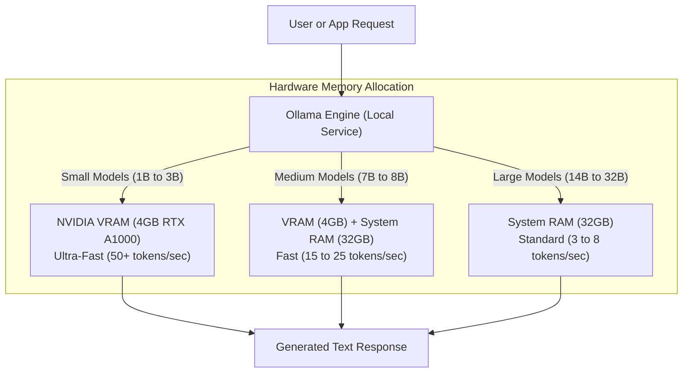

## Overview

Running local Large Language Models (LLMs) allows developers to execute artificial intelligence models directly on their own hardware without sending data to external cloud servers. This approach ensures total data privacy, eliminates API subscription costs, enables offline work, and provides full control over AI model choices.

On Linux (including Arch-based distributions like CachyOS), tools like **Ollama** leverage NVIDIA CUDA or AMD ROCm to offload model computations directly to your GPU and System RAM.

---

## Key Concepts & How It Works

- **Ollama**: An open-source background daemon and command-line application that downloads, manages, and executes GGUF-formatted LLM weights with automatic GPU acceleration.
- **Quantization (GGUF)**: A compression technique that reduces 16-bit floating-point model weights into 4-bit (`Q4_K_M`) or 5-bit (`Q5_K_M`) integers. This drastically lowers memory requirements while retaining near-original intelligence.
- **VRAM Offloading**: Loading neural network layers directly into the graphics card's dedicated Video RAM for high-speed matrix calculations (>50 tokens/sec).
- **RAM Offloading**: Splitting larger models across dedicated VRAM and system memory (RAM). When a model exceeds VRAM size, remaining layers execute on system CPU and RAM.

---

## Visual Diagram




---

## Practical Setup & Usage Guide

### 1. Installation on CachyOS / Arch Linux

Install the CUDA-optimized Ollama package using `pacman`:

```bash
# Install Ollama with NVIDIA CUDA support
sudo pacman -S ollama-cuda

# Start and enable the systemd service
sudo systemctl enable --now ollama
```

### 2. Verify GPU Acceleration

Ensure Ollama correctly detects your NVIDIA GPU drivers:

```bash
# Check service status
systemctl status ollama

# If GPU is not automatically detected, edit systemd service:
sudo systemctl edit ollama
```

Add the following environment variables if GPU detection requires explicit pass-through:

```ini
[Service]
Environment="NVIDIA_VISIBLE_DEVICES=all"
Environment="NVIDIA_DRIVER_CAPABILITIES=compute,utility"
Environment="OLLAMA_FLASH_ATTENTION=1"
```

Reload and restart:

```bash
sudo systemctl daemon-reload
sudo systemctl restart ollama
```

### 3. Running Local Models

Start interactive chat sessions directly in your terminal:

```bash
# 1. Fast 3B Model (Fully loads in 4GB VRAM)
ollama run llama3.2

# 2. Smart 7B Reasoning / Coding Model (Uses GPU + System RAM)
ollama run qwen2.5:7b

# 3. Code-Specific Model
ollama run qwen2.5-coder:7b
```

### 4. Interacting via REST API

Ollama exposes a local HTTP server on port `11434`:

```bash
curl http://localhost:11434/api/generate -d '{
  "model": "llama3.2",
  "prompt": "Write a Python script to filter a list of numbers.",
  "stream": false
}'
```

---

## Latest Trends & Best Practices

- **Flash Attention (`OLLAMA_FLASH_ATTENTION=1`)**: Enables memory-efficient attention computation, significantly reducing VRAM usage during long context windows.
- **Model Keep-Alive (`OLLAMA_KEEP_ALIVE=24h`)**: Prevents Ollama from unloading the model from RAM/VRAM after inactivity, eliminating cold-start delays.
- **GGUF Quantization Standard**: Standardize on `Q4_K_M` or `Q5_K_M` quantizations. They offer the optimal trade-off between memory footprint and output quality.
- **Open WebUI**: Pair Ollama with Open WebUI (run via Docker) for a ChatGPT-like graphical interface supporting file uploads, web search, and user roles.

---

## Related Notes

- [[AI Tools]]
- [[Vector Database]]
- [[Linux]]
- [[CachyOS]]
- [[Pacman Basic Usage]]
- [[Docker]]
